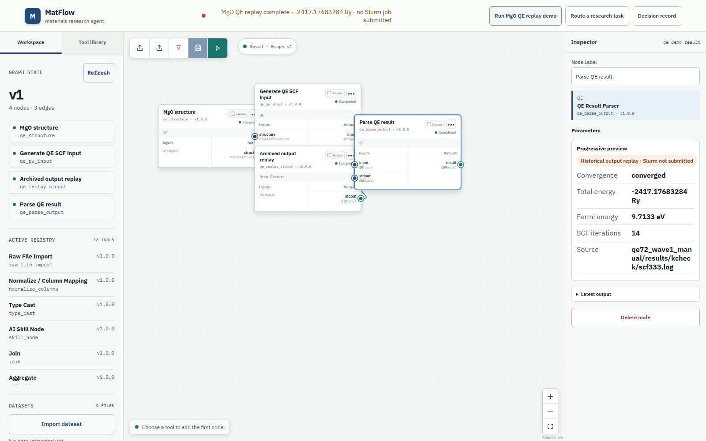
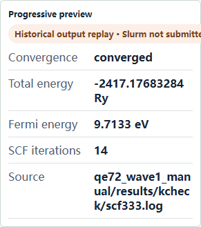

# MatFlow Frontend

权威 MatFlow 后端的客户端界面与适配器：[github.com/Syanz7755/matflow](https://github.com/Syanz7755/matflow)（两个仓库并列放置时的本地备用链接：[../matflow/README.md](../matflow/README.md)）。本仓库从不直接写入 MatFlow 工作区文件；WebUI、MCP、DSH 及未来的客户端都通过带版本的 HTTP API 访问后端。

**兼容的后端契约：** `matflow-http` v1（客户端接受 `>=1.0 <2.0`；后端当前通过 `GET /api/capabilities` 声明 `1.0`）。若契约名称或主版本不符，WebUI、MCP bridge 与 DSH 适配器会拒绝启动。

## 你将看到什么

WebUI 是由后端类型化工作流图驱动的研究工作台：

- 提示区：提交自然语言研究任务，并查看可审计的路由决策（候选工具、理由、安全处理建议）；
- 工作流图编辑器：带类型端口、节点级审核闸门、数据集导入、JSON 导出/导入以及 AI 辅助的节点修订；
- 结果面板：渐进式预览；一键 **Run MgO QE replay demo** 会构建四节点 Quantum ESPRESSO 工作流，并显示解析出的能量与收敛情况，明确标注为历史回放（不会运行 `pw.x`，也不会提交 Slurm 作业）。

## 截图

占位图，需在运行后端与 WebUI 后截取（截图要求见后端的 `docs/images/README.md`）：





## 安装与运行

```powershell
npm install
npm run dev
```

WebUI 默认使用 `http://127.0.0.1:8000/api`。两个仓库并列放置时，后端可以自动定位并管理它：

```powershell
Set-Location ..\matflow
uv run matflow start --ui webui
```

## 工作区布局

- `apps/webui`：React/Vite 研究工作台。
- `packages/api-client`：共享的 `matflow-http` v1 客户端及兼容性检查。
- `packages/mcp-bridge`：仅依赖 HTTP API 的 MCP Streamable HTTP 适配器。
- `integrations/dsh`：DSH 审批与受控的本地文件导入。

## MCP 与 DSH

先启动 MatFlow 后端，然后：

```powershell
npm run mcp
```

MCP 端点为 `http://127.0.0.1:8001/mcp`。要准备隔离的 DSH profile，运行 `npm run configure:dsh`，然后在后端与 bridge 运行时执行 `dsh --profile matflow`。

## 验证

```powershell
npm test
npm run build
npm run test:e2e
```

当后端仓库不在默认的并列目录 `../matflow` 时，设置 `MATFLOW_BACKEND_ROOT`。

## 文档语言

本仓库以英文为主。文档以英文 `X.md` 编写，中文版本保留为同级的 `X.zhcn.md`，两者保持同步。测试、夹具和示例中的中文文本是用于验证中文交互路径的输入数据，不是文档。

## 许可证

MIT，见 [LICENSE](LICENSE)。
